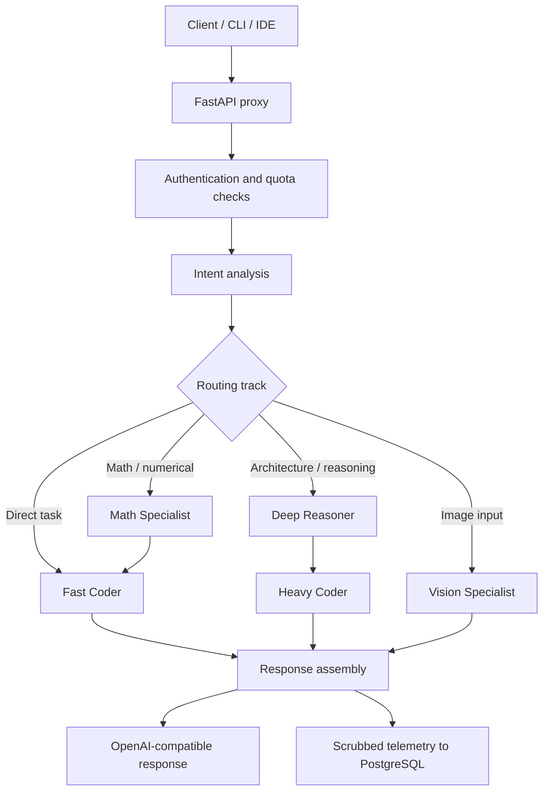

# VOLT-AI architecture

VOLT is an API-compatible multi-model coordination and observability platform. This document describes the routing behavior implemented in `app/coordinator.py`; it is not a promise that every request invokes every specialist.

## Request flow

## Implemented routing tracks

The current intent analyzer selects a route from the latest user message:

| Track | Trigger | Specialist selection |
|---|---|---|
| `fast_coding` | Default direct coding or routine repair | `fast_coder` |
| `two_pass_reasoning` | Reasoning/architecture keywords or long prompts | `deep_reasoner`, then `heavy_coder` |
| `two_pass_reasoning` | Math/numerical keywords | `math_specialist`, then `fast_coder` |
| `vision` | Image content detected | `vision_specialist` |

The reasoner-to-coder and math-to-coder stages are coordinated passes. The implementation should be consulted for exact prompt construction, provider selection, and fallback ordering.

## Specialist fallback

`call_specialist` resolves the configured route, tries the specialist's primary and fallback candidates, may prefer Gemini candidates when the corresponding server configuration is present, and raises a specialist execution error when all candidates fail. Local routes use a shorter timeout than cloud candidates.

Actual provider/model mapping is configuration-dependent. See `routes.json` and `app/coordinator.py` rather than assuming a fixed hosted model.

## API surfaces

- `POST /v1/chat/completions`: OpenAI-compatible chat completions.
- `POST /v1/messages`: Anthropic Messages-compatible proxy.
- `GET /v1/models`: model catalog.
- `GET /health`: database-aware readiness check.
- `GET /stats` and `GET /stats/timeseries`: authenticated usage analytics.
- `GET /tasks` and `GET /tasks/{task_id}`: authenticated task summaries and traces.

The usage and task endpoints enforce authentication and developer/session isolation. Do not expose them directly to anonymous visitors.

## Observability and privacy

The storage layer records call-level operational fields such as selected model, upstream, API style, streaming status, status code, latency, input/output token counts, and scrubbed error metadata. Secret scrubbing is part of the request logging pipeline.

For public portfolio metrics, publish only aggregated values. Never expose raw prompts, completions, session identifiers, user profiles, task traces, API keys, provider credentials, or administrator controls.

## Security boundaries

- Keep provider keys, admin tokens, database URLs, and demo credentials in deployment secrets.
- Do not place administrator credentials in browser JavaScript or WebSocket query strings.
- Public demos should use a dedicated least-privilege credential and strict request quotas.
- Do not connect a public page to the admin live-telemetry WebSocket.
- Keep proprietary platform components and the existing dual-license terms protected.
